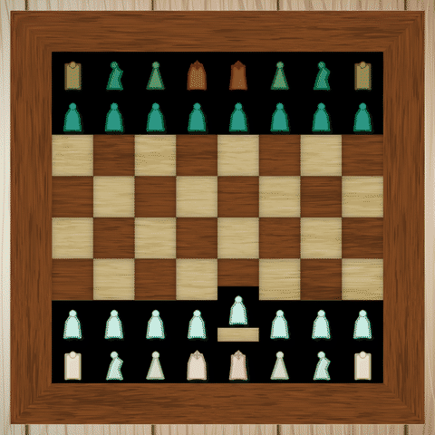
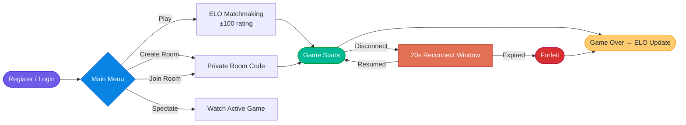
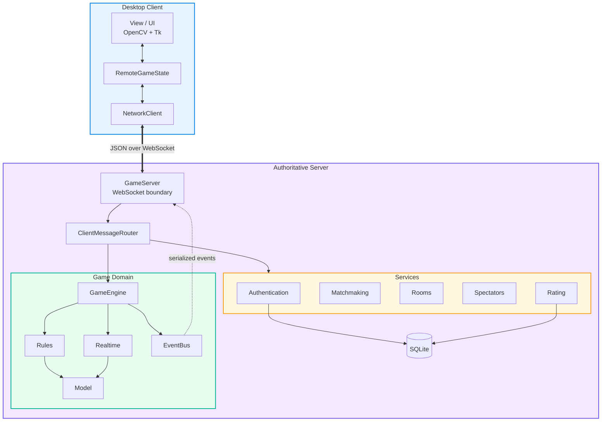
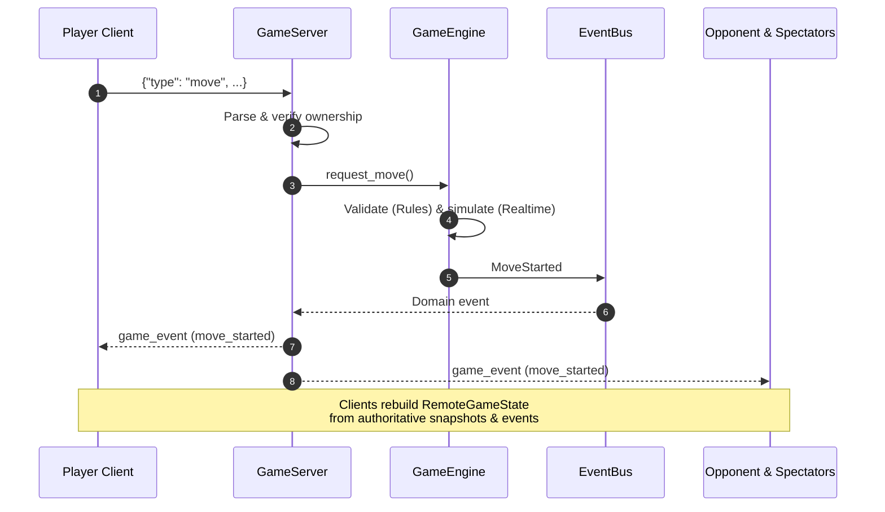

<div align="center">

# ♟️ Kung Fu Chess

### Real-time chess. No turns. No waiting. Pure reflexes.

*A server-authoritative, real-time multiplayer chess engine written in Python —
pieces move through time, jump, collide and capture while the clock never stops.*

<br/>

[](https://github.com/SHULMIT/CTD-Kong-Fu-Chess/actions/workflows/test-coverage.yml)


<br/>

[Features](#features) •
[Quick Start](#quick-start) •
[Multiplayer](#multiplayer) •
[Architecture](#architecture) •
[Protocol](#protocol) •
[Testing](#testing) •
[Security](#security)

<br/>



</div>

---

## What is Kung Fu Chess?

Kung Fu Chess takes the rules of classical chess and **removes the turns**.
Both players move whenever they want — but every move **takes time**, every
piece **recovers** after acting, and pieces in flight can **collide** and
capture each other mid-move.

| Classical Chess | Kung Fu Chess |
| :--- | :--- |
| Players alternate turns | Both players act simultaneously |
| Moves are instant | Pieces travel across the board over time |
| A piece is safe until your opponent's turn | Pieces collide and capture in real time |
| — | Pieces can **jump** to dodge an incoming attack |
| — | Pieces enter short/long **rest** states after acting |

---

<a id="features"></a>

## Features

<table>
<tr>
<td width="50%" valign="top">

### Gameplay
- Real-time offline play in a single process
- Rule-based movement for **all standard pieces**
- Timed movement, **jumping**, collisions & captures
- Pawn **promotion** and game-over detection
- Animated sprite states: idle · move · jump · rest

</td>
<td width="50%" valign="top">

### Multiplayer
- **Server-authoritative** WebSocket architecture
- Rating-based **ELO matchmaking** (±100 points)
- **Private rooms** with short shareable codes
- **20-second reconnect** window with resume tokens
- Read-only **spectator** mode

</td>
</tr>
<tr>
<td width="50%" valign="top">

### Accounts & Rating
- Desktop registration & login
- **scrypt** password hashing with random salts
- Persistent **ELO** ratings (start at 1200)
- Atomic, idempotent rating updates in SQLite

</td>
<td width="50%" valign="top">

### Engineering
- Clean, layered architecture (SRP, low coupling)
- Immutable domain events via an internal `EventBus`
- Structured **JSON-lines** logging with secret redaction
- Unit · integration · system · UI · network tests
- CI with an enforced **80% coverage** gate

</td>
</tr>
</table>

---

<a id="quick-start"></a>

## Quick Start

> [!NOTE]
> Requires **Python 3.14** (the version used in CI) and a desktop environment
> for the OpenCV / Tk windows. A virtual environment is strongly recommended.

```powershell
# 1 Clone
git clone https://github.com/SHULMIT/CTD-Kong-Fu-Chess.git
cd CTD-Kong-Fu-Chess

# 2 Create & activate a virtual environment (Windows)
py -m venv .venv
.\.venv\Scripts\Activate.ps1

# 3 Install dependencies
python -m pip install -r requirements.txt

# 4 Play offline!
python main.py
```

<details>
<summary><b>PowerShell blocks script activation?</b></summary>

<br/>

Use the environment's Python directly, without activating it:

```powershell
.\.venv\Scripts\python.exe -m pip install -r requirements.txt
.\.venv\Scripts\python.exe main.py
```
</details>

<details>
<summary><b>Dependencies</b></summary>

<br/>

| Package | Version | Purpose |
| --- | --- | --- |
| `numpy` | 2.5.1 | Image & board array processing |
| `opencv-python` | 5.0.0.93 | Rendering and the game window |
| `websockets` | 16.1.1 | Multiplayer transport |
| `pytest` | 9.1.1 | Test runner |
| `coverage` | 7.15.2 | Coverage measurement |

`sqlite3`, `hashlib.scrypt`, `asyncio`, `tkinter` and `logging` come from the
Python standard library.
</details>

---

<a id="multiplayer"></a>

## Multiplayer

### One-click launcher (Windows)

```powershell
.\run_multiplayer.bat
```

Starts a hidden local server **plus two desktop clients**, waits for both
clients to close, then shuts the server down.
Requires `.venv\Scripts\python.exe`.

### Manual startup

```powershell
# Terminal 1 — server
.\.venv\Scripts\python.exe -m network.server.main

# Terminal 2, 3, … — one per player or spectator
.\.venv\Scripts\python.exe -m network.client_main
```

Default endpoint: `ws://127.0.0.1:8765`. Point a client elsewhere with
`--uri ws://<host>:<port>`.

> [!TIP]
> Running processes don't hot-reload — restart the server and clients after
> changing the code.

### How to play online



| Step | What happens |
| :---: | --- |
| 1 | **Register** a unique username or **log in** — the menu shows your username and rating |
| 2 | **Play** enters ELO matchmaking (cancellable). Matches only form within 100 rating points |
| 3 | **Create Room** returns a private code; the creator can close it before anyone joins |
| 4 | **Join Room** with a code — the server assigns white/black and starts the game |
| 5 | **Spectate Game** lists active games; spectators receive updates but can't send commands |
| 6 | If a player drops, commands pause for **20 s**. Miss the window → opponent wins by forfeit |

<details>
<summary><b>Server command-line options</b></summary>

<br/>

| Option | Default | Purpose |
| --- | --- | --- |
| `--host` | `127.0.0.1` | WebSocket bind address |
| `--port` | `8765` | WebSocket port |
| `--database` | `data/users.db` | SQLite database path |
| `--k-factor` | `32` | ELO K-factor |
| `--reconnect-timeout` | `20.0` | Resume window in seconds |
| `--log-level` | `INFO` | Server logging level |
| `--log-file` | `data/server.log` | Rotating log file path |
| `--log-max-bytes` | `2000000` | Maximum active log file size |
| `--log-backup-count` | `5` | Number of rotated files retained |

```powershell
.\.venv\Scripts\python.exe -m network.server.main `
  --host 127.0.0.1 `
  --port 8765 `
  --database data/users.db `
  --k-factor 32 `
  --reconnect-timeout 20 `
  --log-level INFO
```
</details>

---

<a id="architecture"></a>

## Architecture

The codebase separates **state, rules, orchestration, transport and
rendering**. Dependencies point toward the domain — never toward the UI or the
network.



### Layer responsibilities

| Layer | Package | Responsibility |
| --- | --- | --- |
| **Application** | `app/` | Composes dependencies and owns the process lifecycle |
| **Controller** | `controller/` | Maps offline input to game commands — no rules |
| **Game** | `game/` | `GameEngine` facade coordinating focused gameplay services |
| **Rules** | `rules/` | Piece movement and move validation |
| **Realtime** | `realtime/` | Motion, timing, airborne state and collisions |
| **Model** | `model/` | Board, piece and position data |
| **Events** | `events/` | `EventBus` and immutable domain events |
| **Network** | `network/` | Commands, serializers, WebSocket server/client, remote state |
| **View** | `view/` | Rendering, input, animation and auth screens |

### Multiplayer event flow



> Deep dives: [`ARCHITECTURE.md`](ARCHITECTURE.md) for the engine layers ·
> [`Server_Design.md`](Server_Design.md) for the proposed cloud-scale design
> (Kubernetes, gRPC microservices, 10M concurrent players).

<details>
<summary><b>Project structure</b></summary>

<br/>

```text
CTD-Kong-Fu-Chess/
├── app/                  Application composition & desktop factories
├── authentication/       Accounts, password hashing, repositories
├── board_io/             Board parsing, loading & text formatting
├── controller/           Offline input → game command adapter
├── events/               EventBus & immutable domain events
├── game/                 GameEngine facade & gameplay services
├── matchmaking/          Thread-safe ELO matchmaking
├── model/                Board, piece & position data
├── network/              Commands, serializers, WebSocket server/client
├── rating/               ELO calculation & persistent updates
├── realtime/             Motion, timing, airborne state, collisions
├── rooms/                Private-room lifecycle
├── rules/                Piece movement & validation rules
├── spectators/           Active games & spectator registry
├── tests/                Unit, game, integration, system, UI, network
├── tools/                Dev & local multiplayer launch helpers
├── view/                 UI, rendering, input, animation, auth views
├── main.py               Offline desktop entry point
└── run_multiplayer.bat   Windows local multiplayer launcher
```
</details>

---

<a id="protocol"></a>

## WebSocket Protocol

All messages are **JSON objects** with a required `type` field. The protocol is
**server-authoritative**: a client-supplied username, rating, color, result or
board state is never trusted.

| Category | Messages |
| --- | --- |
| **Authentication** | `register`, `login`, success / failure responses |
| **Matchmaking** | start, queue status, cancel, `match_found` |
| **Private rooms** | create, join, cancel, lifecycle responses, errors |
| **Gameplay** | move, jump, legal-destination requests, snapshots, events |
| **Reconnect** | resume token, `resume_session`, disconnect notices, forfeits |
| **Spectators** | list active games, start / stop spectating |
| **Ratings** | both player profiles and post-game rating updates |

Engine events are wrapped in a `game_event` envelope:

```json
{
  "type": "game_event",
  "event_id": 1,
  "event": {
    "type": "move_started",
    "piece_id": 7,
    "source": { "row": 6, "column": 0 },
    "target": { "row": 5, "column": 0 }
  }
}
```

Supported event types:
`move_started` · `move_completed` · `jump_started` · `jump_completed` ·
`score_changed` · `game_over`

Wire names live in `network/game_event_type.py`; domain events stay in
`events/game_events.py`, and `GameEventSerializer` performs the explicit
domain → network conversion.

---

## Data & Logging

<table>
<tr>
<td width="50%" valign="top">

### Database
SQLite at `data/users.db`, created automatically on startup.

- **`users`** — unique username, scrypt hash, rating, created-at
- **`game_results`** — `game_id` (PK), winner/loser IDs, new ratings, timestamp

Both rating changes and the result row are written in **one transaction**,
and the `game_id` primary key guarantees a game can never update ratings twice.

</td>
<td width="50%" valign="top">

### Logging
Structured **JSON-lines** records to the console and `data/server.log`
(rotating at 2 MB, 5 backups).

Covers auth, connections, matchmaking, rooms, spectators, game lifecycle,
reconnects, forfeits and rating updates — with `game_id`, `user_id`,
`username` and `room_code` context.

A filter **redacts** passwords, hashes and tokens, even in nested data.

</td>
</tr>
</table>

---

<a id="testing"></a>

## Testing

```powershell
# Full suite
.\.venv\Scripts\python.exe -m pytest -q

# Unit tests only
.\.venv\Scripts\python.exe -m pytest tests\unit -q

# Multiplayer & WebSocket tests only
.\.venv\Scripts\python.exe -m pytest tests\network -q

# Coverage (fails below 80%)
.\.venv\Scripts\python.exe -m coverage erase
.\.venv\Scripts\python.exe -m coverage run -m pytest -q
.\.venv\Scripts\python.exe -m coverage report
```

| Suite | Path |
| --- | --- |
| Unit | `tests/unit` |
| Game | `tests/game` |
| Integration | `tests/integration` |
| System | `tests/system` |
| UI | `tests/ui` |
| Network | `tests/network` |
| Tools | `tests/tools` |

Every push and pull request runs the full suite with coverage on
**GitHub Actions** (`.github/workflows/test-coverage.yml`).

<details>
<summary><b>Manual multiplayer test checklist</b></summary>

<br/>

- [ ] Register two unique users and log in from both clients
- [ ] Each menu shows the correct username and persistent rating
- [ ] Start and cancel a matchmaking search
- [ ] Match two users within 100 rating points and verify both profiles
- [ ] Create a private room, join it by code, and start exactly one game
- [ ] Finish a decisive game and confirm both ELO values refresh
- [ ] Disconnect one player and confirm the opponent sees the countdown
- [ ] Reconnect within 20 s and confirm the same game and color resume
- [ ] Let the reconnect deadline expire → one forfeit, one ELO update
- [ ] Spectate from a third client and confirm move commands are rejected
- [ ] Spectator view closes when the game ends
- [ ] `data/server.log` contains lifecycle records with no credentials or tokens
</details>

---

<a id="security"></a>

## Security

- **scrypt** KDF with random salts and constant-time comparison
- Identity, ratings, colors, rooms, game state and results are **server-controlled**
- Resume tokens from `secrets.token_urlsafe(32)` — **rotated** on resume, invalidated on cleanup
- Spectator gameplay messages are rejected **before** reaching `GameEngine`
- Logs filter sensitive fields and inline secret patterns
- Clients send **intent only** — never legality, captures, scores, winners or ratings

---

## Roadmap & Known Limitations

- [ ] Multiple concurrent games per server *(currently one authoritative `GameEngine`)*
- [ ] Persist reconnect state across server restarts
- [ ] Expanding matchmaking range over wait time *(currently fixed ±100)*
- [ ] In-game chat
- [ ] Bot opponents
- [ ] Player invitations
- [ ] Multi-device participation
- [ ] Cross-platform all-in-one launcher *(current `.bat` is Windows-only, two clients)*
- [ ] Cloud-scale deployment per [`Server_Design.md`](Server_Design.md)

> [!WARNING]
> The project is under **active development**. The offline and local
> multiplayer features are implemented and tested, but it is **not yet
> production-ready** without further deployment, operational and security
> review.

---

## License

No license has been specified yet. Until one is added, all rights are reserved
by the author.

---

<div align="center">

**Made with ♟️ and ⚡ by [SHULMIT](https://github.com/SHULMIT)**

If you like this project, give it a ⭐ on GitHub!

</div>
